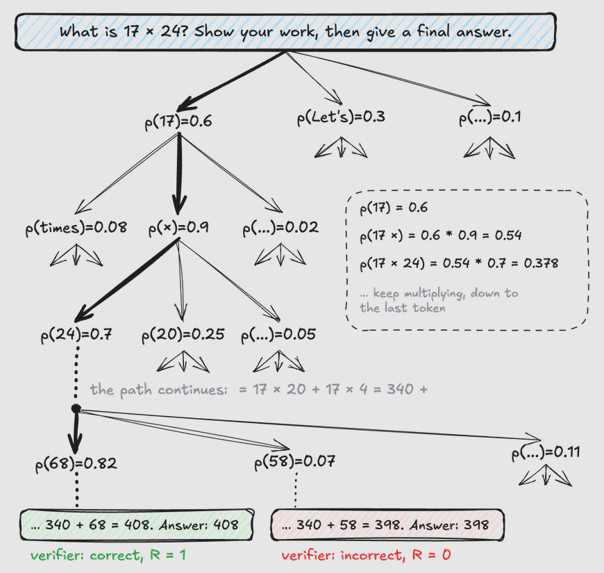
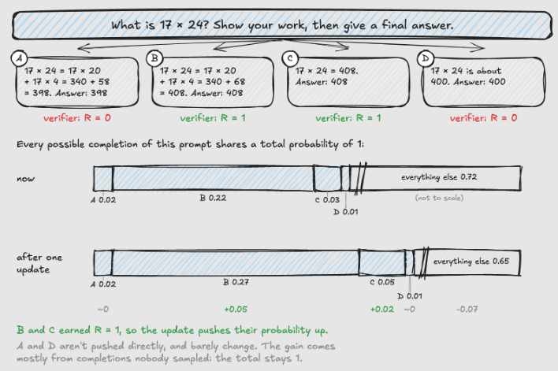

# Reinforcement Learning for LLMs

https://cameronrwolfe.substack.com/p/llm-rl

https://chatgpt.com/c/6acba816-3ee0-83eb-9b62-837e400b7c23

https://cameronrwolfe.substack.com/p/agentic-rl

Reinforcement learning (RL) has played a crucial role throughout the history of research on large language models (LLMs)
Many of the most pressing problems we are trying to solve _today—reasoning_, _knowledge work_, _agents_, _token
efficiency_, _reliability_,
and more are being addressed through RL.

In this overview, we will work up to the frontier of RL research by starting from first principles.

## General framework for RL

A formal structure for RL, outlining the learning objective used for RL training.

### Actions

> When running RL training, we have an **agent** that, at every time step $t$ iteratively
> takes **actions $a_t$** within some **environment**;

### Policy

> The actions are predicted by a **policy** **$\pi_{\Theta}$
** (we can think of this as the agent’s brain)
> with parameters $\Theta$ (e.g., the policy is the LLM itself in the context of training an LLM).

Our policy can either be <u>deterministic</u> or <u>stochastic</u>, but for LLMs we will assume the policy
is **stochastic**.

Our stochastic policy $\pi_{\Theta}$ outputs a probability distribution over the set of possible actions,
and an action $a_t$ is sampled from this distribution.

> The **policy** is denoted as conditional probability
> $$\pi_{\Theta}(a|s)=P(A=a_t|S=s_t)$$

with $\sum_a\pi_{\Theta}(a|s)=1 \: \forall s$

### Environment, state and Transition function

> When the policy outputs an action, **the state of the environment will be updated according to
a transition function**, which is part of the environment.

> **Transition function**: $P(s_{t+1}|a_t,s_t)$

### Reward

> After an action is taken, the environment provides a **reward
** **$r_t$** (positive, negative or zero), which characterizes the desirability of
> a given state or action.

Intuitively, we can **conceptualize RL as a trial and error process**. As our agent acts
in its environment, the training process reinforces—either positively or negatively—observed behavior via the reward.
Hence, the name “reinforcement” learning.

### Process

Beginning from an initial state $s_0$ that is sampled from a distribution $d_0$ over the set of initial states,
the agent will repeatedly:

* Sample actions ($a_t$).

* Transition to a new state (s_t+1).

* Receive a reward (r_t).

This process will continue until the final state $s_t$ is reached in case:

* $s_t$ is a **terminal state**
* a pre-defined **maximum number of steps** has been reached

### Trajectory / Completion

The sequence of actions, states and rewards

In the LLM world the trajectory is called **completion**:

> Given a prompt $x$, a language model generates a **completion
** $y=(y_1, y_2, \dots ,t_T)$ one token at a time

The probability of the trajectory, is calculated by the combination of policy and transformation
using the chain rule:

> The same way we have the **completion probability**:
> $$p_{\Theta}(y | x) = \prod_{t=1}^Tp_{\Theta}(y_t|x, y_{\lt t})$$

The product of all the probability of the current token geneated at time $t$, given the input and all the
previous tokens ($\lt t$)

Generating a completion traces one path through a tree of possible continuations.

### Return / reward function

For reasoning tasks, the **reward function** is often a verifier $R(x,y)$  if the final answer is correct and

$$
R(x,y)\colon
\left\{
\begin{array}{rcl}
\mathbf{1} & \longrightarrow & \text{correct answer} \\
\mathbf{0} & \longmapsto & \text{otherwise}
\end{array}
\right.
$$

This setup is often called RL with verifiable rewards (RLVR). Math problems with a known answer and coding tasks with
unit tests are common examples.

### The objective function of RL

#### Expectation as average reward

> Our goal is to find the parameters θ (parameters of LLM) that maximize the expected reward, which we call
> the **objective J(θ)**
> $$J(\Theta)=\mathbb{E}_{x \sim \mathcal{D},y \sim p_{\Theta}(\cdot| x)}[R(x,y)]$$

where

* $x\sim\mathcal{D}$: a prompt $x$ drawn from a dataset (distribution) $\mathcal{D}$.
* $y\sim p_\Theta(\cdot\mid x)$: a response $y$ sampled from the model with parameters $\Theta$, given the prompt. The dot means “the distribution over all $y$”.
$R(x,y)$: a scalar reward for that prompt/response pair (e.g. from a reward model).
* $J(\Theta)$: the average reward the model earns. Training maximizes it.

$$J(\Theta)=\mathbb{E}_{x\sim\mathcal{D},\,y\sim p_\Theta(\cdot\mid x)}[R(x,y)]=\sum_x \mathcal{D}(x)\sum_y p_\Theta(y\mid x)\,R(x,y)$$

An expectation is $(probability) × (value)$ summed over outcomes. 

Here the outcomes are pairs $(x,y)$ with probability $\mathcal{D}(x)\,p_\Theta(y\mid x)$.

#### Fix the prompt

We fix the prompt (it is impossible to estimate all possible prompts given to an LLM) **$\mathcal{D}(x)=1$**

$$J(\Theta)=\sum_y p_\Theta(y)\,R(y)$$

In general RL, an agent collects a reward after each of many actions, and the objective is the expected total reward
over an episode, often discounted.
<u>Generating a completion is an episode where each token is an action and the only reward comes at the end</u>, so the
total is just $R(y)$

### The policy gradient (gradient with respect policy parameters)

To improve the model, we want to follow the gradient of the objective, $\nabla_\Theta J(\Theta)$  the direction in
parameter space that most increases the expected reward.

Written out, the objective is a sum over every possible completion:

$$\nabla_{\Theta}(J(\Theta))=\nabla_{\Theta}\sum_y p_{\Theta}(y)R(y)=\sum_y \nabla_{\Theta}p_{\Theta}(y)R(y)$$

if we apply a **log derivative trick**: 
* $\nabla log(f)=\frac{\nabla f}{f}$ we can write
* $\nabla (f)= f \cdot \nabla log(f)$
* so $\nabla_{\Theta}p_{\Theta}(y)=p_{\Theta}\nabla_{\Theta} \log{p_{\Theta}}$
* The gradient becomes: $\nabla_{\Theta}(J(\Theta))=\sum_y p_{\Theta}(y)\nabla_{\Theta}\log{ p_{\Theta}(y)}R(y)$ which is

> $$\nabla_{\Theta}(J(\Theta)) = \mathbb{E}_{y \sim p_{\Theta}}[R(y)\nabla_{\Theta}\log{ p_{\Theta}(y)}]$$

The $\nabla_{\Theta}\log{ p_{\Theta}(y)}$ is called  **score function**

> So the gradient is the expected value of the return if the completion multiplied the score function for the same
> completion.

### Monte Carlo policy gradient

The calculation of the expected value requires the everage of all possible complations, given the prompt, which is
computationally not feasible.

We rather use the 

**Monte Carlo estimate from N randomly sampled trajectories/completions **

$$J(\Theta) \approx \frac{1}{N}\sum_{i=1}^{N}R(y_{i})\nabla_{\Theta}\log{ p_{\Theta}(y_i)} \text{ where } y_{i} \sim p_{\Theta} $$

> It estimates the gradient by averaging over complete sampled rollouts, using each one’s actual reward rather than a
> learned estimate of how good it was.

Each term pairs a direction with a weight: the score points toward making that rollout’s completion more likely, and the
reward sets how much that direction counts.

Because all completions share a total probability of 1, B’s and C’s gains come from elsewhere, here mostly from
completions nobody sampled.

A barely changes, because it shares everything up to “340 +” with B, so reinforcing B also lifts most of A’s path.

The numbers are only illustrative: B and C are pushed up, but how every other completion moves depends on how the
model’s parameters are shared.

> Policy gradient is supervised fine-tuning on your own samples, weighted by reward. With +1/0 rewards, as in the figure
> above, it is literally SFT on the correct completions, so incorrect completions are never pushed down directly; they
> only lose share.

### From sequence to tokens

The score function for a single completion $\nabla_{\Theta}\log{ p_{\Theta}(y)}$ brakes down to a sum of per-token
log-probabilities (one term per token)

$$\nabla_{\Theta}\log{ p_{\Theta}(y_i)}=\sum_{t=1}^T\nabla_{\Theta}\log{ p_{\Theta}(y_t|y_{\lt t},x)}$$

* each term is the **score of each token**: the direction that most increases the probability of choosing $y_t$, given the
  previous generation and the prompt

For example, the current generation is until `340 +`, the LLM will generate a prob distribution for each token $v$ in
the
vocabulary, so that for each we have a corresponding logit

Step 4: derivative with respect to the logits of Softmax gradient in Claude

$z_v \rightarrow p_v=softmax(z_v)$

$p_v=p_{\Theta}(v|y_{\lt t})$ and $s_v=\nabla_{\Theta}\log{p_{v}}$

We know a LLM (mostly decoder-only) transformer based produces probabili

Suppose the model produces $p_68=0.82$ and $p_58=0.07$

| Rule | Name                           | Expression                                                                                                                                               | Used in    |
|------|--------------------------------|----------------------------------------------------------------------------------------------------------------------------------------------------------|------------|
| A    | Log-derivative                 | $\displaystyle \frac{d}{dx}\ln f(x)=\frac{f'(x)}{f(x)}\;\Longrightarrow\;\nabla f=f\,\nabla\ln f$                                                        | Steps 1, 4 |
| B    | Log of a quotient              | $\displaystyle \ln\frac{x}{y}=\ln x-\ln y$                                                                                                               | Step 3     |
| C    | Log undoes exp                 | $\displaystyle \ln e^{x}=x$                                                                                                                              | Step 3     |
| D    | Derivative of exp inside a sum | $\displaystyle \frac{d}{dz}e^{z}=e^{z},\qquad \frac{\partial}{\partial z_k}\sum_j e^{z_j}=e^{z_k}$                                                       | Step 4     |
| E    | Multivariable chain rule       | $\displaystyle \frac{\partial\log\pi(a)}{\partial\theta_{m,i}}=\sum_k\frac{\partial\log\pi(a)}{\partial z_k}\,\frac{\partial z_k}{\partial\theta_{m,i}}$ | Step 5     |
| F    | Derivative of a linear layer   | $\displaystyle z_k=\sum_i\theta_{k,i}s_i\;\Longrightarrow\;\frac{\partial z_k}{\partial\theta_{m,i}}=\delta_{km}\,s_i$                                   | Step 5     |