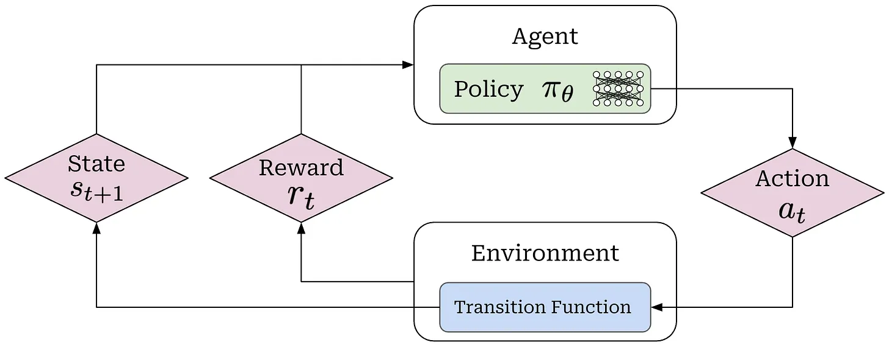

# Reinforcement Learning for LLMs 

https://cameronrwolfe.substack.com/p/llm-rl

https://cameronrwolfe.substack.com/p/agentic-rl

Reinforcement learning (RL) has played a crucial role throughout the history of research on large language models (LLMs)
Many of the most pressing problems we are trying to solve _today—reasoning_, _knowledge work_, _agents_, _token efficiency_, _reliability_, 
and more are being addressed through RL. 

In this overview, we will work up to the frontier of RL research by starting from first principles.

## General framework for RL

A formal structure for RL, outlining the learning objective used for RL training.

### Actions

> When running RL training, we have an **agent** that, at every time step $t$ iteratively takes **actions $a_t$** within some **environment**; 

### Policy
> The actions are predicted by a **policy** **$\pi_{\Theta}$** (we can think of this as the agent’s brain) 
> with parameters $\Theta$ (e.g., the policy is the LLM itself in the context of training an LLM).  

Our policy can either be <u>deterministic</u> or <u>stochastic</u>, but for LLMs we will assume the policy is **stochastic**. 

Our stochastic policy $\pi_{\Theta}$ outputs a probability distribution over the set of possible actions, 
and an action $a_t$ is sampled from this distribution. 

> The policy is denoted as conditional probanility 
> $$\pi_{\Theta}(a|s)=P(A=a_t|S=s_t)$$

with $\sum_a\pi_{\Theta}(a|s)=1 \: \forall s$

### Environment, state and Transition function

> When the policy outputs an action, **the state  of the environment will be updated according to a transition function**, which is part of the environment. 

> **Transition function**: $P(s_{t+1}|a_t,s_t)$ 

### Reward

> After an action is taken, the environment provides a **reward** **$r_t$** (positive, negative or zero), which characterizes the desirability of a given state or action. 

Intuitively, we can **conceptualize RL as a trial and error process**. As our agent acts in its environment, the training process reinforces—either positively or negatively—observed behavior via the reward. Hence, the name “reinforcement” learning.

### Process

Beginning from an initial state $s_0$ that is sampled from a distribution $d_0$ over the set of initial states, 
the agent will repeatedly:

* Sample actions ($a_t$).

* Transition to a new state (s_t+1).

* Receive a reward (r_t).

This process will continue until the final state $s_t$ is reached in case: 
* $s_t$ is a terminal state 
* a pre-defined maximum number of steps has been reached

> 
 

