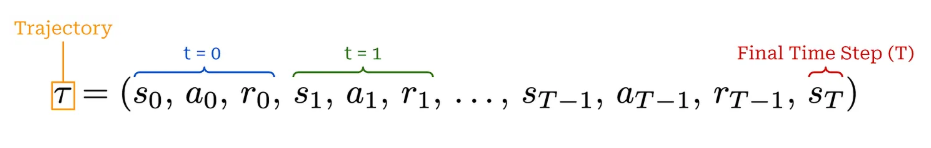
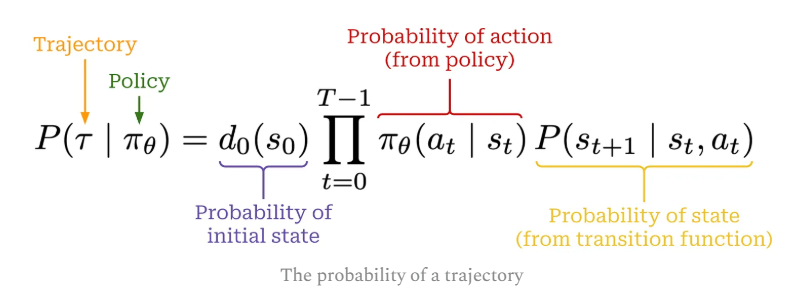
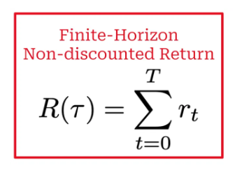
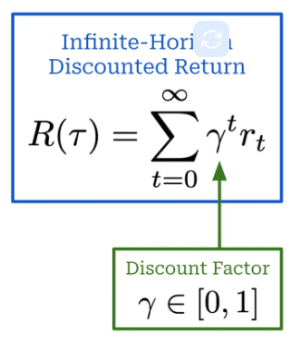
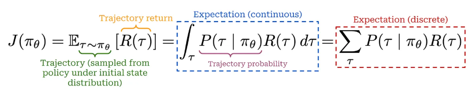

# Reinforcement Learning for LLMs

https://cameronrwolfe.substack.com/p/llm-rl

https://chatgpt.com/c/6acba816-3ee0-83eb-9b62-837e400b7c23

https://cameronrwolfe.substack.com/p/agentic-rl

Reinforcement learning (RL) has played a crucial role throughout the history of research on large language models (LLMs)
Many of the most pressing problems we are trying to solve _today—reasoning_, _knowledge work_, _agents_, _token
efficiency_, _reliability_,
and more are being addressed through RL.

In this overview, we will work up to the frontier of RL research by starting from first principles.

## General framework for RL

A formal structure for RL, outlining the learning objective used for RL training.

### Actions

> When running RL training, we have an **agent** that, at every time step $t$ iteratively
> takes **actions $a_t$** within some **environment**;

### Policy

> The actions are predicted by a **policy** **$\pi_{\Theta}$
** (we can think of this as the agent’s brain)
> with parameters $\Theta$ (e.g., the policy is the LLM itself in the context of training an LLM).

Our policy can either be <u>deterministic</u> or <u>stochastic</u>, but for LLMs we will assume the policy
is **stochastic**.

Our stochastic policy $\pi_{\Theta}$ outputs a probability distribution over the set of possible actions,
and an action $a_t$ is sampled from this distribution.

> The **policy** is denoted as conditional probability
> $$\pi_{\Theta}(a|s)=P(A=a_t|S=s_t)$$

with $\sum_a\pi_{\Theta}(a|s)=1 \: \forall s$

### Environment, state and Transition function

> When the policy outputs an action, **the state of the environment will be updated according to
a transition function**, which is part of the environment.

> **Transition function**: $P(s_{t+1}|a_t,s_t)$

### Reward

> After an action is taken, the environment provides a **reward
** **$r_t$** (positive, negative or zero), which characterizes the desirability of
> a given state or action.

Intuitively, we can **conceptualize RL as a trial and error process**. As our agent acts
in its environment, the training process reinforces—either positively or negatively—observed behavior via the reward.
Hence, the name “reinforcement” learning.

### Process

Beginning from an initial state $s_0$ that is sampled from a distribution $d_0$ over the set of initial states,
the agent will repeatedly:

* Sample actions ($a_t$).

* Transition to a new state (s_t+1).

* Receive a reward (r_t).

This process will continue until the final state $s_t$ is reached in case:

* $s_t$ is a **terminal state**
* a pre-defined **maximum number of steps** has been reached

### Trajectory

The sequence of actions, states and rewards

The probability of the trajectory, is calculated by the combination of policy and transformation
using the chain rule:

The **** or **** of the trajectory is the
sum of all rewards of the trajectory. It is denoted in two versions

| Finite horizon not discounted return          | Infinite horizon discounted return                                                                                                                                              | 
|-----------------------------------------------|---------------------------------------------------------------------------------------------------------------------------------------------------------------------------------|
| total length of the trajectory $T$ is finite  | Infinite trajectory with a **discount factor** $\gamma \in [0,1]  $  The exponent makes the lower time steps contributions more relevant |
|  |                                                                                                                                        |

Ways to caluclate the return can be also based on the current state in a per-token
base ([KL penalties](https://cameronrwolfe.substack.com/p/direct-preference-optimization?open=false#%C2%A7kullback-leibler-kl-divergence))
or
[Generalized Advantage Estimation (GAE)](https://cameronrwolfe.substack.com/i/175107358/generalized-advantage-estimation-gae-3)
where a discount factor is used recursively

> **Return based on status $s_t$** 
> $$G_t=\sum_{i=0}^{\infty}\gamma^ir_{t+i}$$

> **Recursive return**
> $$G_t=r_t+\gamma G_{t+i}$$

### The objective function of RL

> The objective function for RL is to **maximize the expected return of the current policy** expressed as 
> expectation over sampled trajectories, (either as an integral or a discrete probability-weighted sum) over possible trajectories

The estimation over all possible trajectories is not computationally feasable.

We rather use the **Monte Carlo estimate from N randomly sampled trajectories**

$$\hat J(\pi_{\Theta})=\frac{1}{N}\sum_{i=1}^{N}R(\tau_{i}) \text{ where } \tau_{i} \sim \pi_{\Theta} $$

>The **RL OBJECTIVE** is then the set of parameters for the maximal return (estimated) function

> $$\Theta^* \rightarrow argmax(\hat J(\pi_{\Theta}))$$

### Gradient ascend

Despite the Backpropagation optimization where we want to minimize the 
errors, updating weights following the gradient descent, here we want to 
**maximise the return, therefore we muve towards gradient ascent**.

> The solution is the **gradient ascent for the policy parameter update**

> $$\Theta_{k+1} = \Theta_{k} + \alpha $$

To perform gradient ascent, however, we must be able to compute the gradient of this objective with respect to the parameters of our policy

