# LLM training

## Notation FLOP, FLOPS

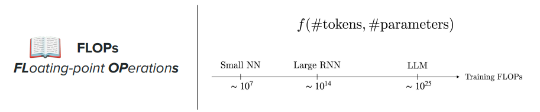


## Performance

How the model performance evolves as function of the model size and the training size


The following picture shows that for a certain amount of input tokens on the x-axis, a bigger model (the colors towards
yellow)
produce less loss, therefore better performance


### Chinchilla law

Based on a fix amount of compute (FLOPS) what are the ideal model size and training set size.

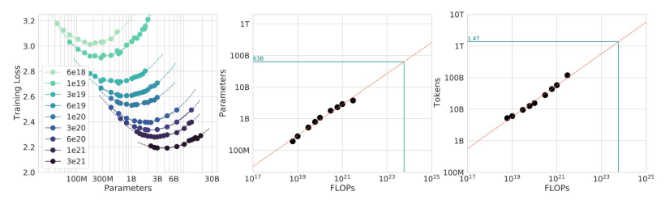

The coloured lines are per compute size.


As a rule of thumbs, the ideal sizes are <u>training set size 20 times the model size</u>.

### Knowledge cutoff

> The knowledge of the model is updated up to the time of the update time of the training data provided.

This means that if the question is about information after that date the model can retrieve that info from
external sources

```mermaid
flowchart LR
    classDef success fill: #d4edda, stroke: #28a745, color: #155724;
    classDef danger fill: #f8d7da, stroke: #dc3545, color: #721c24;
    classDef warning fill: #fff3cd, stroke: #ffc107, color: #856404;
    classDef blue fill: #6497b1, stroke: #03396c, color: #011f4b;
    Node1[Cutoff knowledge]:::success
    Node2[Extrarnal source - Web search]:::warning
    Node4[LLM]:::blue -.-> Node1
    Node4[LLM]:::blue -.-> Node2

```

It is hard to add new knowledge to an already pre-trained model, because the weights are already determined and are
not changed at inference time.

The risk is to introduce <span style="color:#FF0000">**plagiarism**</span>, the tendency of copying parts of answers
from external sources and not
as part of elaboration.

## What is pre-training

The traditional way of training language model was to train on a specific task

> We apply it to <span style="color:red">**decoder-only transformer based LLMS**</span> as text-to-tex next generation
> tokens solution

Training language models is highly expensive, so the idea is to use a pre-trained model and fine tune it for the
specific task

```mermaid
flowchart LR
    classDef success fill: #d4edda, stroke: #28a745, color: #155724;
    classDef danger fill: #f8d7da, stroke: #dc3545, color: #721c24;
    classDef warning fill: #fff3cd, stroke: #ffc107, color: #856404;
    classDef blue fill: #6497b1, stroke: #03396c, color: #011f4b;
    Node1[Spam detection]:::success
    Node2[Sentiment extraction]:::warning
    Node3[Translation model]:::danger
    Node4[Pre-trained LLM]:::blue -.-> Node1
    Node4[Pre-trained LLM]:::blue -.-> Node2
    Node4[Pre-trained LLM]:::blue -.-> Node3

```

This is what BERT does as explained here: [bert_deep_dive.md](../2-Tranformers%20based%20models/bert_deep_dive.md)

> So the pretrained model is trained with (MLM or NSP) to learn the "basics" of the target language. Then the same model
> is trained with the specific task trianing set

> The pre-training is <u>always</u> to predict the next token.

## Pre-training

> Train the LLM to learn the language structure and rules

* a large portion of text is given to the LLM where a <span style="color:red">**tokenizer**</span> is applied
* for each token in the prompt the LLM will produce the <span style="color:red">**next token**</span>
* estimation with a <span style="color:red">**diagonal matrix self-attention mask**</span> to drive attention to all the
  previous to the current token (not in the future)
  
* the process is <span style="color:red">**parallelized**</span>, the matrices are for multiple inputs at the same time

### Cross entropy loss as object function

> Train the model parameters $\Theta$ to maximize the probability of the token we want from the training, given the
> previous tokens

We make it a minimization problem with the $-$ sign

$\mathfrak{L}_{CE}=-\frac{1}{T} \sum_{t=1}^T log(p_{\Theta}(x_t|x_{<t}))$

At each time step the LLM produces probabilities for the $n$ tokens in the vocabulary

$p_{\Theta}(x_1,x_2, \cdots, x_n)$ this can be expressed as

$p_{\Theta}(x_1) \times p_{\Theta}(x_2 | x_1) \times p_{\Theta}(x_3 | x_1, x_2) \cdots \times p_{\Theta}(x_n | x_1, \cdots, x_n) =$

which is

$= \prod_{t=1}^{n} p_{\Theta}(x_t | x_{<t})$

We solve the problem of the numerical instability of the product of many values between 0 and 1 using the $log$

$-log(\prod_{t=1}^{n} p_{\Theta}(x_t | x_{<t}))=-\sum_{t=1}^{n}log(p_{\Theta}(x_t | x_{<t}))$

It is a function of $\Theta$

### Training data for pre-trained models

* natural language
    * Common crawl (https://commoncrawl.org/) - Over 300 billion pages spanning 19 years.
    * Wikipedia
* Code
    * Github
    * StackOverflow

Examples are:

* GPT-3 trained on a training set of 300Bi of tokens
* Llama 3 15 Trilions

Repetitions has value: the paper [Scaling Data-Constrained Language Models](https://arxiv.org/pdf/2305.16264)
measures held-out test loss (model’s average next-token cross-entropy on text it never trained on to measure
generalization, but not memorization),
not training loss, as the same data is repeated for more epochs. The behavior has three regimes:

| Epochs    | What happens to test loss                                                                                                                    |
|-----------|----------------------------------------------------------------------------------------------------------------------------------------------|
| 1 to ~4   | Almost the same as having unique data. The 8.7B model at 4 epochs finished with only 0.5% higher validation loss than at 1 epoch             |
| ~4 to ~16 | Gains continue, but each repeated token is worth less. The paper fits R*_D ≈ 15.4, so ~16 epochs is the “half-life”.                         |
| ≫ 16      | Returns collapse toward zero. At ~40 epochs repeating is nearly worthless, and for some runs loss gets worse (44 epochs diverges in Fig. 4). |

### Pre-training data preparation

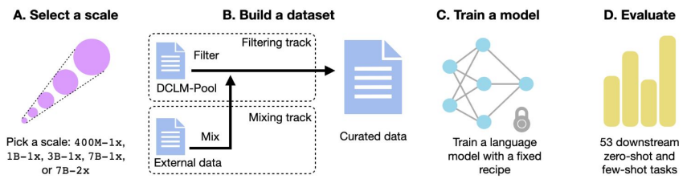

The idea is to train smaller LLM with specialized data (Github, papers, Stackoverflow...) and check which performs
better.
This way a mixture of percentages of those training data sources for the big LLM training set is determined.

Approx GLM-5 used 30T (trilions $10^{12}$) tokens for pre-training.

### Mid-training

Insert a middle phase of training between pre-training and SFT to specialize
the model on the final field of application.


### Long context training - YaRN (Yet Another Rope extensioN method)

The pre-training is usually using input sequences of ~k of tokens, but at inference
time, if we want to mid or fine tune train the model on longer sequences (the model might receive longer sequences 10k,
100k of tokens)

The training uses the position
embedding [RoPE](../2-Tranformers%20based%20models/transformer_components#rope-rotary-position-embeddings)

RoPE rotates each pair of query/key dimensions by an angle `m·θ_i`, where m is the token position and
`θ_i = 10000^(-2i/d)`.
Low-index dimensions rotate fast (high frequency), high-index dimensions rotate slowly (low frequency).
The model only ever sees rotation angles up to the training length L, so at positions beyond L it faces angles it never
learned,
and attention quality collapses.

**Position Interpolation (PI)** fixes this by squeezing all positions by `s = L'/L`: use `m/s` instead of `m`.

* This keeps angles in the trained range, but it shrinks every frequency equally.
* The high-frequency dimensions, which encode fine local distinctions between neighboring tokens, get compressed so that
  adjacent tokens look nearly identical.
* Result: degraded short-range precision, and it needs fine-tuning to recover.

**YaRN’s intuition** is that dimensions shouldn’t be treated uniformly. It splits them by how many full rotations they
complete within the original context L:

* High-frequency dims (many rotations within L): already see every phase during training, so they extrapolate fine.
  Leave them unchanged.
* Low-frequency dims (less than one rotation within L): never complete a cycle, so extrapolating would create unseen
  angles. Interpolate them fully (divide by s).
* Middle dims: blend linearly between the two with a ramp function (this is the “NTK-by-parts” scheme).

If we want train on <span style="color:red">**long context**</span> input sequences the model will see data for position
embedding
that he never saw before (the longer context implies different values for the position embedding used in pre-training)

## SFT Supervised Fine Tuning

A pretrained model contains only knowledge of the language, it is not orientated on solving any problem.
Therefore, it will only try to generate the most probable token coming after the input text

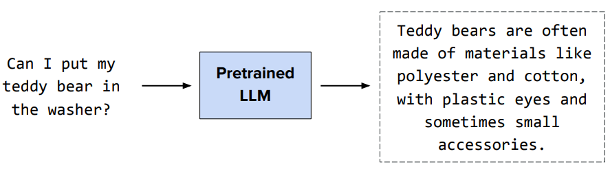

> Change the model behavior by tuning its weights

* The training pairs input/desired output are oriented to the new goal
* The model is still produce the expected the next word for the desired output

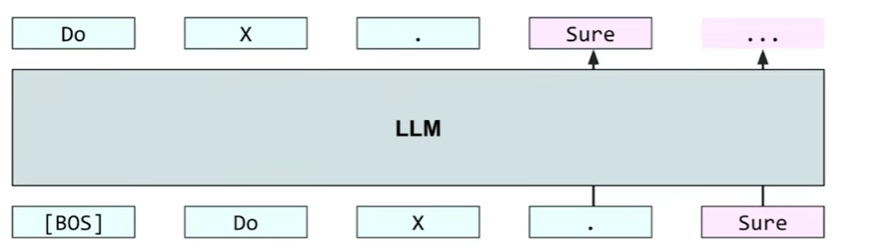

> The objective function is still the next token cross entropy loss.


given the input prompt and the token generated so far

$$\mathfrak{L}_{CE}=-\frac{1}{T} \sum_{t=1}^T log(p_{\Theta}(y_t|x,y_{<t})) $$

### SFT training data

* mixture of human generated and synthetic data
* the scale is ~1000M of examples (much lower than pre-training)

> Instruction tuning is the fine-tuning technique finalized to answering complex instructions

For pre-training, we have seen that the training data are huge datasets (wikipedia, dedicated sets of bilions of page)
to allow the model to derive the language knowledge.

The training data can be divided into several sub topics, where the training data represent
the instruction and a potential expected response from the model.


### The target object

* **Pre-training**: For a decoder-only LLM such as GPT, pre-training is usually self-supervised.

Given the input `The cat is sitting on the`, the model training is for the next token, so, in general

```text
x₁  x₂  x₃  x₄  ...  xₙ
 ↓   ↓   ↓   ↓
x₂  x₃  x₄  x₅  ...  xₙ₊₁
```

> The targets are simply the tokens already present in the training text, shifted by one position.

> "Given everything before this position, what token comes next?"

> The <span style="color:red">**loss**</span> is calculated for each new predicted token

```text
PRE-TRAINING

Huge corpus
    ↓
"The capital of France is Paris..."
    ↓
predict next token
    ↓
learn language + knowledge + patterns
```

* <span style="color:red">**Supervised fine-tuning**</span>: target = desired response

```text
Instruction:
Explain why the sky is blue.

Target:
The sky appears blue because molecules in Earth's atmosphere
scatter shorter wavelengths of sunlight more strongly...
```

> Since causal LLMs are always producing a prediction for the next token, here the <span style="color:red">**loss
**</span>
> is calculated for the entire model response (so it can be compared to the expected output)

```text
SFT

Human-designed examples
    ↓
"Question → desired answer"
    ↓
predict next token of desired answer
    ↓
learn how to respond to instructions
```

A way to generate the examples is to give instructions as input of pre-existing LLMs,
given the output, validate it with other LLMs or via human validation.

Subsets of SFT data regard also the model behavior to enforce the model to reject harmful content or
vulgarities, safety alignment.

The size is

| Model   | SFT data (# examples) |
|---------|-----------------------|
| GPT-3   | 13k                   |
| Llama 3 | 10M                   |

> SFT data size is usually several order of magnitude lower than the size of the pre-training data set.


### Parameter-efficient fine-tuning with LoRA (Low Rank Adaptation)

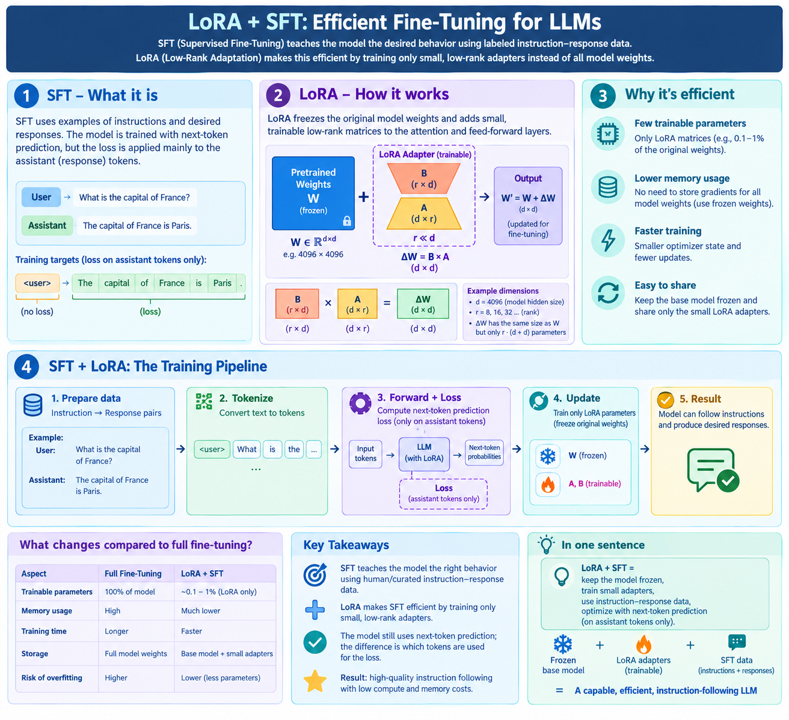

> LoRA makes easy to train the same pretrained model for different fine-tuning tasks, because we can isolate the
> fine-tuning trained weights, making SFT training more efficient

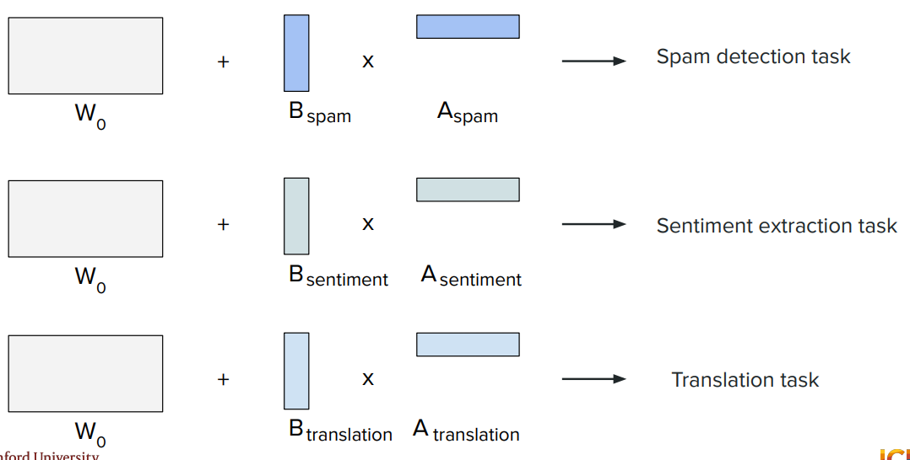

#### Where LORA applies

Even though lora is nowadays applied to both self-attention layer and FFNN layer it has been demonstrated that
it gives <span style="color:red">**better performance improvement on the FFNN layer**</span>.

## Preference tuning - reinforcment

SFT trained LLM might bisbehave

```text
                                                                      
                                                                      
                        ┌────────────────┐                            
  Should I wash my      │                │      I would suggest not   
  Teddy bear       ────►│  LLM           ┼────► to spend time with    
                        │     SFT        │      Teddy bear at all.    
                        │                │                            
                        └────────────────┘                            
                                                                      
```

For instance, we don't want a response like this.

So far we never instructed the <span style="color:red">**LLM about what not to do**</span>.

Pairs of good and not good expected outputs are given to the LLM:

* for each prompt we have a winning and a losing response
* not scalable, requires human
* based on data quality
* easier to collect pairwise data of $(x_1,\hat{y_1})$ $(x_2,\hat{y_2})$ and compare the quality of the generated
  response

We need a reinforcment mechanism

## RLHF (Reinforcment Learning from Human Feedback)

**STEP 1**: for each $(x,\hat{y})$ the human feedback assigns a score to it: $r(x_1,\hat{y_1})$

**STEP 2**: reinforcement learning the score is used to steer the model response

#### Bradley-Terry formulation

Suppose we have two responses generated by an LLM:

- Response A has reward $r_i=3$.
- Response B has reward $r_j=1$.

> The formulation expresses the probability that a human choices i over j,
> this is model as the sigmoid of the difference of the sigmoid

> $P(A \prec B) = \frac {e^{r_i}}{e^{r_i}+e^{r_j}}=\sigma(r_i - r_j)$

where the sigmoid is $\sigma(x)=\frac{1}{1+e^{-x}}$

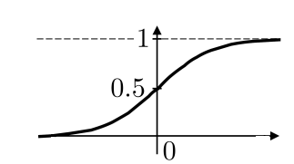

> The probability depends on the difference of rewards and not on their direct values

* for equally rewarded outputs the probability is 50% -> $0.5$ )value of the sigmoid
* in our case $P(A \succ B)=\sigma(3-1) =\sigma(2)\approx 0.881$

#### The reward model

There are multiple ways to implement a reward model. One is the following

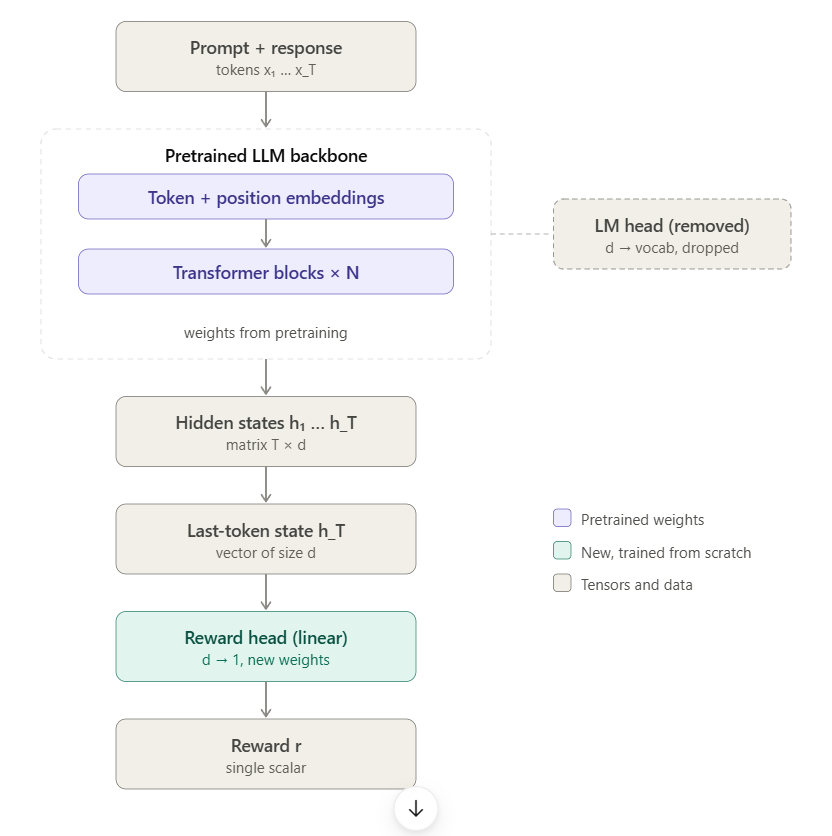

it is a standard transformer based model where the last linear layer generating the
next token probabilities is replaced by a linear layer that maps the $h_t \in \mathbb{R}^d$ dimensioned logit output
into
single scalar reward value.

### PHASE 1: Training the reword model with the Bradley-Terry formulation

We use pairs of rewarded sequences where one is the winning response (high reward)

$\hat{y_w}$ paired with a loosing response $\hat{y_l}$ (lower reward)

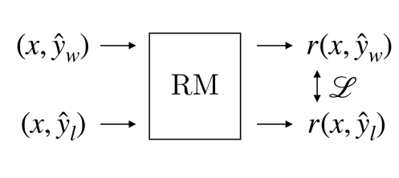

We calculate the cross entropy loss based on the probability of choosing the
winning response (maximize) . We minimize the loss compared to the probability
of choosing the winning.

$max(p_{\Theta}(\hat{y}_w \succ \hat{y}_l))$ which is for
Bradley-Terry $max(\sigma(r_{\Theta}(x,\hat{y}_w)-r_{x,\Theta}(\hat{y}_l)))$

* monotone function we can use SGD
* we use the log for numeric stability
* we use the opposite as a minimization model
* we normalize based on the number of pairs

$$\mathfrak{L}(\Theta)=-\frac{1}{T}\sum_{i=1}^T\sigma(r_{\Theta}{(x,\hat{y}_w)}_i-r_{\Theta}{(x,\hat{y}_l)}_i)$$

This we can express as the expected value of a distribution in a 3-d space of prompt, winning and loosing
ouput $(x,\hat{y}_w,\hat{y}_l) \in \mathfrak{D}$

> $$\mathfrak{L}(\Theta)=-\frac{1}{T}\mathbb{E}[\sigma(r_{\Theta}{(x,\hat{y}_w)}_i-r_{\Theta}{(x,\hat{y}_l)}_i)]$$


> At the end of the training phase we obtained a <span style="color:red">**model capable of estimate a reward
**</span> $r(x,\hat{y})$

### PHASE 2: Reinforcement learning

> Align the LLM weights (the RM here is fixed) to penalize bad answers and promote good answers using the reward model
> as an evaluator

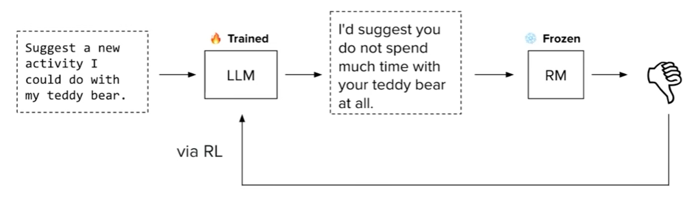

The <span style="color:red">**objective function**</span> here is to tune the answers for a model that is already
trained,
so we want to adjust the weight without deviating too much from the base model.

## Direct Preference Optimization (DPO)

It is a technique for aligning an LLM with human preferences. Its central intuition is:

> Instead of teaching the model what a good answer looks like, teach it to prefer a good answer over a bad one.


DPO uses preference pairs to directly optimize the model with a loss function

$$\mathcal{L}_{DPO}(\pi_\theta; \pi_{ref}) =
-\mathbb{E}_{(x,y_w,y_l)\sim \mathcal{D}}
\left[
\log \sigma
\left(
\beta \log \frac{\pi_\theta(y_w|x)}{\pi_{ref}(y_w|x)}

-

\beta \log \frac{\pi_\theta(y_l|x)}{\pi_{ref}(y_l|x)}
\right)
\right]$$

Where:

* $\pi_\theta$: policy model being trained.
* $\pi_{ref}$: reference model. Used as a comparison
* $y_w$: preferred response.
* $y_l$: rejected response.
* $\beta$: controls the strength of KL regularization.
* $\sigma$: sigmoid function.
* $\mathcal{D}$: dataset of preference pairs.

The loss function is a remodulation of the Bradley-Terry formulation with a direct way of calculating the reward

Intuitively:

1. Increase the probability of the preferred response.
2. Decrease the probability of the rejected response.
3. Compare both changes against a reference model to prevent the model from drifting too far from its original behavior.
4. Use the sigmoid to turn the difference into a preference probability.

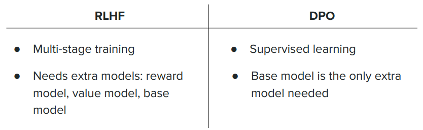

## Reasoning

Initially OpenApi with ChatGPT has announced in 11/2024 the capability of the model to implement a reasoning chaing to
produce output for prompt requiring logical steps (calculus, coding) to produce the final answer.

### CoT Chain-Of-Thoughts

We have seen that a model can describe the steps required to produce the final answer, if instructed to do so

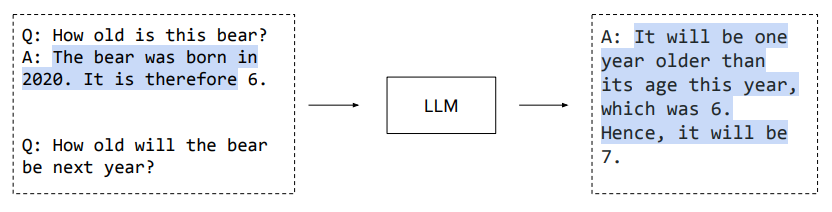

So models can be trained to generate next tokens of the logical steps of a problem that helps the model itself by
the principle of _divide et impera_.

The paper (Stealing Reasoning Traces from Proprietary LLM APIs)[https://arxiv.org/abs/2608.09867] has
extracted the hidden reasoning from the major models by tweaking the APIs.

> the <span style="color:red">**thinking effort**</span> can also be set up with sliders in many models because it
> changes the number of tokens generated
> by the model (therefore counted in the quotas) even though not visible to the final user.

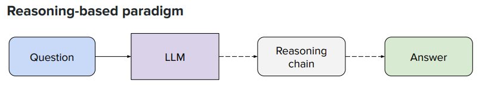

An advantage of reasoning in math or coding problems is that we can train the model with simplified rewards for
`correct` or `wrong` answers and if they contain a reasoning chain (if there are <u>reasoning tokens</u> like
`first`, `next`, `then`, in a template format).

### GRPO Group Relative Policy Optimization

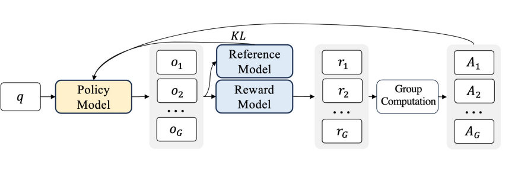

* the prompt $q$ is given to the `policy` (LLM)
* the `policy` generates the several responses $o_i$
* the `reward model` evaluates the response (here we know exactly if the response is correct or not)
  with <span style="color:red">**verifiable rewards**</span> $r_i$
* the `group determination` rather than evaluating a response against an absolute reward scale,
  it <span style="color:red">**evaluates it against the performance of its group of outputs for the same prompt
  **</span> (normalization of the rewards).
* the advantages $A_i$ measures <span style="color:red">**how much better or worse a generated response is compared to
  the average response in its group**</span>
* the <span style="color:red">**loss to maximize advantages**</span> is still compared to a `base model` to avoid the
  train to deviate too much from the pre train model

## Distillation

What we have seen is that the <span style="color:red">**reward applies to the output sequence as a whole, we don't have
a measurement at token level**</span>.

We have algorithms with pros and cons

|      | PROS                                                                                                                                  | CONS                                                                                                |
|------|---------------------------------------------------------------------------------------------------------------------------------------|-----------------------------------------------------------------------------------------------------|
| SFT  | **dense signal**: we have evaluation of the output for each generated token                                                           | **off-policy**: we use a dataset of demonstrations written by humans or generated by another model. |
| RLHF | **on-policy**: the model generates the responses that are subsequently evaluated by a reward model and used to update that same model | **sparse signal**: the reward is assigned to an entire generated response                           |
|      |

### On-policy distillation

> We use a specialized model  called <span style="color:red">**teacher**</span> 
> to create a dense signal evaluation of the tokens generated by the training model called <span style="color:red">**student**</span>

instead of relying on a reward for the entire answer

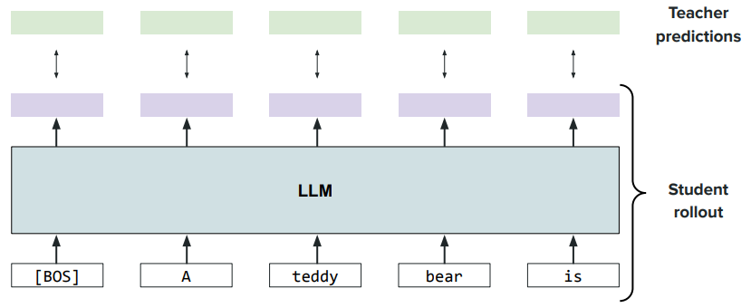

There is also a variation based on <span style="color:red">**Multi-teacher on-policy distillation**</span>.

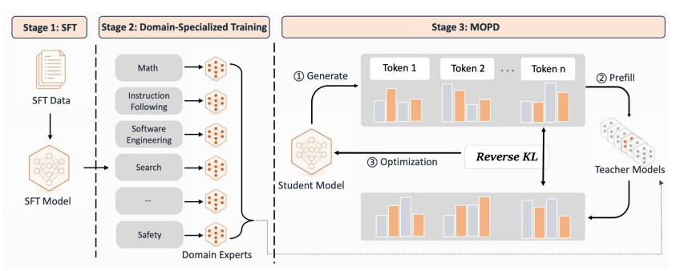


