# LLM training

The traditional way of training language model was to train on a specific task

Training language models is highly expensive, so the idea is to use a pre-trained model and fine tune it for the
specific task

```mermaid
flowchart LR
    classDef success fill: #d4edda, stroke: #28a745, color: #155724;
    classDef danger fill: #f8d7da, stroke: #dc3545, color: #721c24;
    classDef warning fill: #fff3cd, stroke: #ffc107, color: #856404;
    classDef blue fill: #6497b1, stroke: #03396c, color: #011f4b;
    Node1[Spam detection]:::success
    Node2[Sentiment extraction]:::warning
    Node3[Translation model]:::danger
    Node4[Pre-trained LLM]:::blue -.-> Node1
    Node4[Pre-trained LLM]:::blue -.-> Node2
    Node4[Pre-trained LLM]:::blue -.-> Node3

```

This is what BERT does as explained here: [bert_deep_dive.md](../2-Tranformers%20based%20models/bert_deep_dive.md)

> So the pretrained model is trained with (MLM or NSP) to learn the "basics" of the target language. Then the same model
> is trained with the specific task trianing set

> The pre-training is <u>always</u> to predict the next token.

## Training data for pre-trained models

* natural language
    * Common crawl (https://commoncrawl.org/) - Over 300 billion pages spanning 19 years.
    * Wikipedia
* Code
    * Github
    * StackOverflow

Examples are:

* GPT-3 trained on a training set of 300Bi of tokens
* Llama 3 15 Trilions

## Notation FLOP, FLOPS

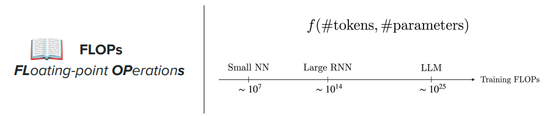

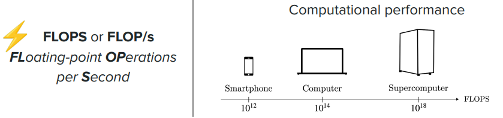

## Performance

How the model performance evolves as function of the model size and the training size

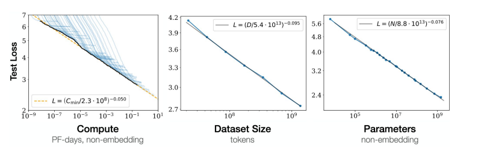

The following picture shows that for a certain amount of input tokens on the x-axis, a bigger model (the colors towards
yellow)
produce less loss, therefore better performance

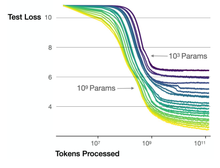

### Chinchilla law

Based on a fix amount of compute (FLOPS) what are the ideal model size and training set size.

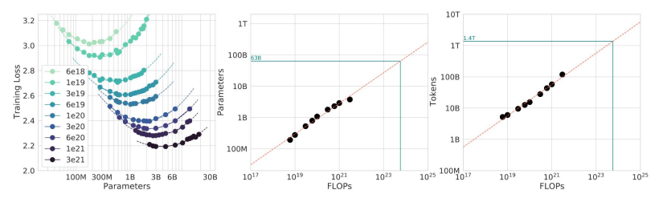

The coloured lines are per compute size.


As a rule of thumbs, the ideal sizes are <u>training set size 20 times the model size</u>.

### Knowledge cutoff

> The knowledge of the model is updated up to the time of the update time of the training data provided.

This means that if the question is about information after that date the model can retrieve that info from
external sources

```mermaid
flowchart LR
    classDef success fill: #d4edda, stroke: #28a745, color: #155724;
    classDef danger fill: #f8d7da, stroke: #dc3545, color: #721c24;
    classDef warning fill: #fff3cd, stroke: #ffc107, color: #856404;
    classDef blue fill: #6497b1, stroke: #03396c, color: #011f4b;
    Node1[Cutoff knowledge]:::success
    Node2[Extrarnal source - Web search]:::warning
    Node4[LLM]:::blue -.-> Node1
    Node4[LLM]:::blue -.-> Node2

```

It is hard to add new knowledge to an already pre-trained model, because the weights are already determined and are
not changed at inference time.

The risk is to introduce <span style="color:#FF0000">**plagiarism**</span>, the tendency of copying parts of answers
from external sources and not
as part of elaboration.

## Training in decoder only LLMs - Adam optimizer

The problem of training decoder-only LLMs models involves updated different type of weights for each transformer layer

* the <u>masked self attention layer</u>: $Q=XW_Q$, $K=XW_K$,$V=XW_V$ so that we
  have $Attention(Q,K,V)=softmax(\frac{QK^\mathsf{T}+M}{\sqrt{d_k}})V$
* the <u>output</u> $O=Attention(Q,K,V)W_O$
* the FFN(x) with the typical two projections $n \rightarrow m \rightarrow n$: $\sigma(xW_1+b_1)W_2+b_2$
* token embeddings (RoPE)
* Layer normalizations
* MoE (if present)

> The training compares the next token probability $P(mat∣The cat is sitting on the)$ with the target to calculate the
> loss

### The traditional SGD is not used

The Stochastic Gradient Descent

$\Theta_{t+1}=\Theta_{t}-\eta g_t$ ($\eta$ learning rate) ($g_t=\nabla_\Theta L_t$)

An LLM may have billions of parameters, and different parameters can have very different gradient behavior.

Adam addresses this by maintaining information about the gradients over time.

### The Adam optimizer

For each parameter $\Theta$, Adam memorizes two values

* <span style="color:#FF0000">**First moment**</span>: a exponentially moving average of the gradient (it provides
  momentum.)

$$m_t=\beta_1m_{t-1}(1-\beta_1)g_{t}$$

* <span style="color:#FF0000">**Second moment**</span>: the variance of recent gradients

$$v_t=\beta_2v_{t-1}(1-\beta_2)g^2_{t}$$

Considering that $m_0=0$ and $v_0=0$, the first iterations are biased towards zero.
For this reason is is used a corrected form of the two moments with what is called <span style="color:red">**bias
correction**</span>

> $$\hat m_t=\frac{m_t}{1-\beta _1^t}$$

and

> $$\hat v_t=\frac{v_t}{1-\beta _2^t}$$

So the <span style="color:red">**parameter update**</span> is

> $$\Theta_{t+1}=\Theta_{t}+\eta\frac{\hat m_t}{\sqrt{\hat v_t}+\epsilon}$$

where $\eta$ is the learning rate and $\epsilon$ is a correction parameter $ \sim10^{-8}$

> Adam allows updates of different orders of magnitudes of parameters in a LLM because it is based on the
> historical values of the gradients for those parameters.

Conceptually:

$$ \frac{\text{gradient}} {\sqrt{\text{historical gradient}^2}} $$

Therefore, parameters with very different gradient scales can receive appropriately scaled updates.

This is particularly useful in huge neural networks containing many different types of parameters.

### The AdamW optimizer

> AdamW is generally more relevant than the original Adam. It decouples the weight decay parameter $\lambda$

Cnceptually:

> $$ \theta_{t+1} = \theta_t - \eta \frac{\hat m_t} {\sqrt{\hat v_t}+\epsilon} - \eta\lambda\theta_t $$

where $\lambda$ is the weight-decay coefficient.

So the update becomes

```mermaid
flowchart LR
    classDef success fill: #d4edda, stroke: #28a745, color: #155724;
    classDef danger fill: #f8d7da, stroke: #dc3545, color: #721c24;
    classDef warning fill: #fff3cd, stroke: #ffc107, color: #856404;
    classDef blue fill: #6497b1, stroke: #03396c, color: #011f4b;
    Node1[Forward pass]:::blue --> 
    Node2[Logits]:::blue -->
Node3[Cross Entropy loss]:::blue -->
Node4[Backpropagation]:::blue -->
Node5[Gradients]:::blue --> AdamW
subgraph AdamW [AdamW]
direction TB
Node6[Momentum m]:::warning -->
Node7[Second Momentum v]:::warning -->
Node8[Bias correction]:::warning -->
Node9[Adaptive step]:::warning -->
Node10[Weight decay]:::warning

end
AdamW --> Node11[transformer
weights
update]:::blue

```

The problem with the optimizer is the <span style="color:red">**memory cost**</span>

Suppose to have a LLM with :

$$ N=7\text{ billion} $$

For each parameter, Adam maintains

* model parameters
* gradients
* first moment $m$
* second moment $v$

So, only the additional moments memory requirement is re approximately:

$$ 2\times 7\text{B}\times4\text{ bytes} ≈56 GB $$

## The problem of memory

> During LLM training we need to keep track of the loss gradient for each parameter, including the weight updates
> for optimizer (Adam or AdamW).


For a high end graphic board with $\sim 10 GB$ memory.

### Data parallelism - ZeRO (Zero Rerundandcy Optimization)

> the idea is to involve several GPUs in the computing of the backward by <span style="color:red">**dividing data in
batches and process
> them in replicated instance of the model**</span>

Cons: gradient calculation based on average of gradients needs forms of aggregation and require communication between
the model replicas decreasing the overall model performance.

The intuition is that there is a lot of duplication in all the instances (redundancy) mostly for
the <span style="color:red">**optimizer state**</span> <u>which is
the most memory consuming part</u>

> <span style="color:red">**ZeRO**</span> creates partitions of parameters, grandients and optimizer state across the
> replicas

We go for a setup where the model is copied
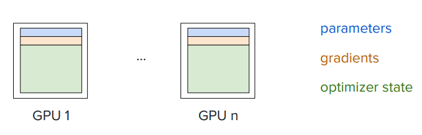

to one where data are partitioned

| ZeRO-1                        | ZeRO-2                        | ZeRO-1                        |
|-------------------------------|-------------------------------|-------------------------------|
| 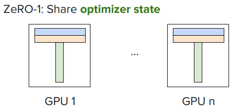 | 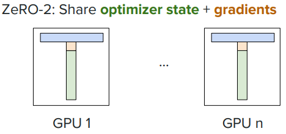 | 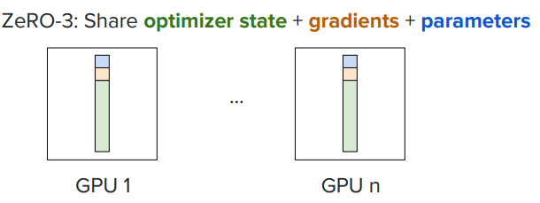 |

> Increases communication costs by reduces the memory management

## Model parallelism

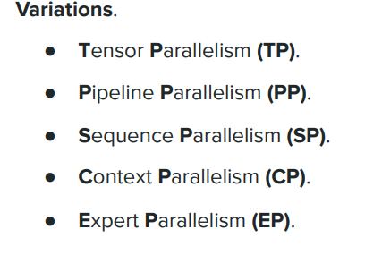

Strategies to parallelize the model onto several GPUs

* <span style="color:red">**Pipeline parallelism**</span>: distribute transformer layers across GPUs
* <span style="color:red">**Expert parallelism**</span>: distribute the experts in MoE across GPUs

## Optizimation via Flash Attention

### The internal architecture of GPU

We distinguish two tipes of memory:

* <span style="color:red">**HBM**</span>: large storage $\sim 10 GB$, $v\sim TB/s$
* <span style="color:red">**SRAM**</span>: small $\sim 10 MB$ and fast on-chip memory. Tens times faster than
  HBM $v\sim 10\times TB/s$.

So

$\text{softmax}(QK^\top / \sqrt{d_k})$

### Computation of self-attention with no optimization

1. Load $Q$ and $K$ from <span style="color:blue">**HBM**</span> blocks
2. Perform the multiplication $S=QK^\mathsf{T}$
3. Write $S$ to <span style="color:blue">**HBM**</span>
4. Load $S$ from <span style="color:blue">**HBM**</span> blocks
5. Perform $P=softmax(S)$
6. Write $P$ to <span style="color:blue">**HBM**</span>
7. Load $P$ and $V$ from <span style="color:blue">**HBM**</span> blocks
8. Perform $O=PV$
9. Write $O$ to <span style="color:blue">**HBM**</span>

The load and write for such big matrices ($Q$ has $n$ length of the sequence rows) is the <u>bottleneck</u>

### Flasf self attention 1

> Send "tiles" (subparts) of the matrices to be computed to the SRAM which can perform full end-to-end computation (in
> chip) and send it
> back to HBM

Minimize the reads and writes to the HBM.

#### Softmax computation

The problem with the tiling is the softmax computation because it is based on the sum of all the exponentials over the
row
to calculate the prob distribution.

> A naive block-by-block softmax would need the global max in advance, which you don't have until you've seen every
> block.

Softmax over a row $x \in \mathbb{R}^n$ is (numerically stable)

$$\operatorname{softmax}(x)_i = \frac{e^{x_i - m}}{\sum_{k=1}^n e^{x_k - m}}, \qquad m = \max_k x_k$$

#### Inline softmax

The fix: keep two running scalars per row — a running max $m$ and a running (rescaled) sum $l$ — and update them as each
tile arrives, rescaling on the fly whenever the max changes.

Initialize:
$$m^{(0)} = -\infty, \qquad l^{(0)} = 0$$

For each tile $j$ with values $x^{(j)}$:

$$m^{(j)} = \max\left(m^{(j-1)},\ \max_i x_i^{(j)}\right)$$

$$l^{(j)} = l^{(j-1)} \cdot e^{\,m^{(j-1)} - m^{(j)}} + \sum_i e^{\,x_i^{(j)} - m^{(j)}}$$

After the final tile $T$, the exact softmax of every element seen so far (regardless of which tile it came from) is:

$$\operatorname{softmax}(x_i) = \frac{e^{\,x_i - m^{(T)}}}{l^{(T)}}$$

> **Why this is exact, not an approximation:** $l^{(j)}$ is always maintained
> as $\sum_{k \le j} \sum_i e^{x_i^{(k)} - m^{(j)}}$ — the sum of *all* exponentials seen so far, expressed relative to
> the *current* max. When the max increases from $m^{(j-1)}$ to $m^{(j)}$, every term computed under the old max needs to
> be multiplied by $e^{m^{(j-1)} - m^{(j)}}$ to re-express it relative to the new max — that's exactly the rescale term.
> No information is thrown away, and no exponential ever overflows, because every term is computed relative to the max
> seen at that point.

#### Numeric example


Take $x = [3,\ 1,\ 4,\ 1,\ 5,\ 9]$, processed in tiles of size 2.

**Tile 1: $[3, 1]$**
$$m^{(1)} = \max(-\infty, 3) = 3$$
$$l^{(1)} = 0 + \left(e^{3-3} + e^{1-3}\right) = 1 + 0.1353 = 1.1353$$

**Tile 2: $[4, 1]$**
$$m^{(2)} = \max(3, 4) = 4$$
$$l^{(2)} = 1.1353 \cdot e^{3-4} + \left(e^{4-4} + e^{1-4}\right) = 1.1353(0.3679) + (1 + 0.0498) = 0.4178 + 1.0498 = 1.4676$$

**Tile 3: $[5, 9]$**
$$m^{(3)} = \max(4, 9) = 9$$
$$l^{(3)} = 1.4676 \cdot e^{4-9} + \left(e^{5-9} + e^{9-9}\right) = 1.4676(0.006738) + (0.018316 + 1) = 0.009888 + 1.018316 = 1.028204$$

**Check against the direct computation** ($\sum_i e^{x_i - 9}$ over the whole array):
$$e^{-6}+e^{-8}+e^{-5}+e^{-8}+e^{-4}+e^{0} = 0.002479+0.000335+0.006738+0.000335+0.018316+1 = 1.028203$$

Matches (up to rounding). Final softmax values, $e^{x_i-9}/1.028204$:

| $x_i$   | 3        | 1        | 4        | 1        | 5        | 9        |
|---------|----------|----------|----------|----------|----------|----------|
| softmax | 0.002411 | 0.000326 | 0.006552 | 0.000326 | 0.017811 | 0.972571 |

(sums to 1.0, as expected)


### The inline softmax in the flash self attention

For each tile $j$ we extract $Q^{(j)}$, $K^{(j)}$, $V^{(j)}$ and also a $O^{(j)}$ that is at every tile updated with

$$O^{(j)} = O^{(j-1)} \cdot e^{\,m^{(j-1)} - m^{(j)}} + \sum_i e^{\,x_i^{(j)} - m^{(j)}} \, V_i^{(j)}$$

The algorithm is to get the complete $O \in \mathbb{R}^{N,d_m}$ with (N dimension of the input sequence, $d_m$ dimension of the model)

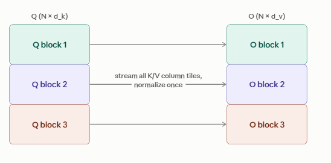

* **outer loop over row blocks**: suppose to have $B_r$ number of blocks, queries at the time
* **inner loop over column tiles**: $B_c$ kys/values at a time computed in the <span style="color:green">**SRAM**</span> in the end-to-end manner
* After the last column tile, divide that block's accumulated numerator by its $l$(broadcast across the $d_k$
columns) — this is the only normalization step, done once per row block.

$$O^{(\text{final})} = O^{(T)} / l^{(T)}$$

* Write that finished $(B_r,d_v)$ chunk into rows $[iB_r:(i+1)B_r]$ of $O$.
* Once every row block has been processed, $O$ is complete 

> FlashAttention compute exact (not approximate) attention output while only ever holding one tile of $Q$, $K$, $V$ 
> and three small running accumulators ($m$, $l$, $O$) in fast memory, avoiding the $O(n^2)$ materialization of the full attention matrix.

### Flash self attention 2

In traditional training we store the activation matrices (at the inner layers) for $S$ and $P$ to be used in the backward pass for 
the calculation of the gradient. 

> Considering that we are now using the fast <span style="color:green">**SRAM**</span> for computing, we no longer store the activation matrices in the forward pass,
we rather recomputed them

> We accept the overhead of more FLOPS operations to save memory requirement

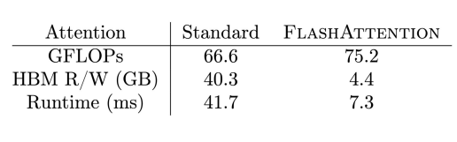

We have increased the runtime substantially too.

## Quantization

What is the float precision trade-off to balance effectiveness and memory requirement.

### Floating point representation

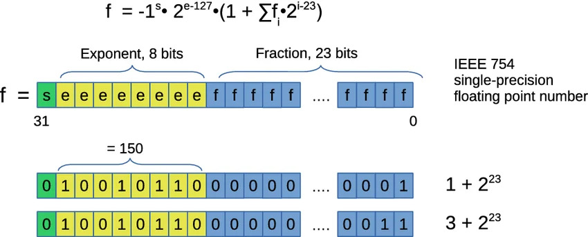

$$f=-1^s\cdot 2^{e-127}\cdot(1-\sum_if\cdot2^{i-23}) $$

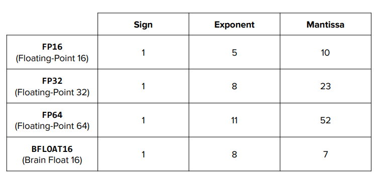

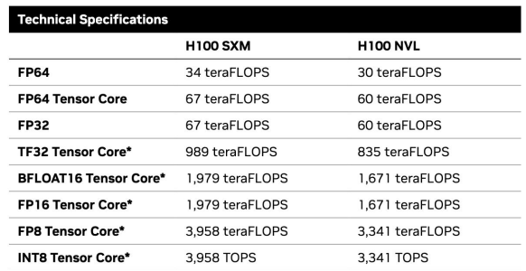

`FP32` requires half of memory compared to `FP64`, but it has more precision error and is faster (67 teraFLOPS instead of 34 teraFLOPS).

### Mixed-precision training

The idea is

* **forward pass**: <u>use low precision</u> $x_{FP32} \rightarrow f \rightarrow \hat y_{FP16}$
* **backward pass**: <u>use low precision</u> $x_{FP32} \rightarrow \nabla f_{FP16} \rightarrow \hat y_{FP16}$
* **weight update**: <u>keep weight in high precision</u> $x_{FP32} \rightarrow f_{FP32} \rightarrow \hat y_{FP16}$
 
This has been tested having the best performance optimization with reduced precision.

The idea justifying the lower precision for estimation and data is that input data are intrinsically noisy so
the amount of information lost with low precision is not much relevant.

It is important to keep the weights with high precision to have stable processing

## Supervised fine-tuning SFT

We have seen many GPT, including BERT models having the training split in two phases 

* <span style="color:red">**Pre-training**</span>: MLM (Masked Language Model) and NSP (Next Sentence Prediction) to have a general knowledge of the language
* <span style="color:red">**Fine tuning**</span>: based on the specific task

So if we just use the pre-trained model we can get the following

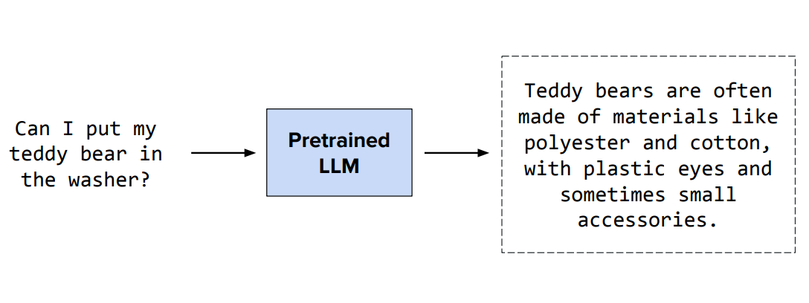

We see here that the model is also based on the <span style="color:red">**next token prediction**</span>, based on the network trained with training data that, 
in this case, might correlate the washing of a teddy bear to the composing material; that's why the 
answer <u>reflects this association without giving back the answer that a user could expect</u>.

Fine-tuning specializes the LLM to respond to specific tasks

> In SFT we provide the pre-trained LLM with input/output data (<u>SFT data</u>) to update model weights with training 
> to implement the <u>task of interest</u>

### The training data for instruction tuning

> Instruction tuning is the fine-tuning technique finalized to answering complex instructions

For pre-training, we have seen that the training data are huge datasets (wikipedia, dedicated sets of bilions of page)
to allow the model to derive the language knowledge.

The training data can be divided into several sub topics, where the training data represent 
the instruction and a potential expected response from the model.

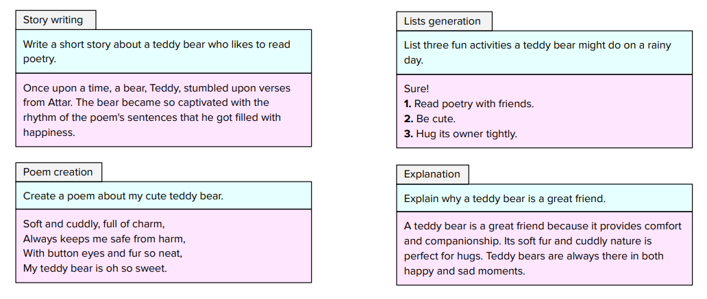

### The target object

* **Pre-training**: For a decoder-only LLM such as GPT, pre-training is usually self-supervised.

Given the input `The cat is sitting on the`, the model training is for the next token, so, in general

```text
x₁  x₂  x₃  x₄  ...  xₙ
 ↓   ↓   ↓   ↓
x₂  x₃  x₄  x₅  ...  xₙ₊₁
```

> The targets are simply the tokens already present in the training text, shifted by one position.

> "Given everything before this position, what token comes next?"

> The <span style="color:red">**loss**</span> is calculated for each new predicted token

```text
PRE-TRAINING

Huge corpus
    ↓
"The capital of France is Paris..."
    ↓
predict next token
    ↓
learn language + knowledge + patterns
```


* <span style="color:red">**Supervised fine-tuning**</span>: target = desired response


```text
Instruction:
Explain why the sky is blue.

Target:
The sky appears blue because molecules in Earth's atmosphere
scatter shorter wavelengths of sunlight more strongly...
```

> Since causal LLMs are always producing a prediction for the next token, here the <span style="color:red">**loss**</span> 
> is calculated for the entire model response (so it can be compared to the expected output)


```text
SFT

Human-designed examples
    ↓
"Question → desired answer"
    ↓
predict next token of desired answer
    ↓
learn how to respond to instructions
```

A way to generate the examples is to give instructions as input of pre-existing LLMs,
given the output, validate it with other LLMs or via human validation.

Subsets of SFT data regard also the model behavior to enforce the model to reject harmful content or
vulgarities, safety alignment. 

The size is 

| Model   | SFT data (# examples) |
|---------|-----------------------|
| GPT-3   | 13k                   |
| Llama 3 | 10M                   |

> SFT data size is usually several order of magnitude lower than the size of the pre-training data set.

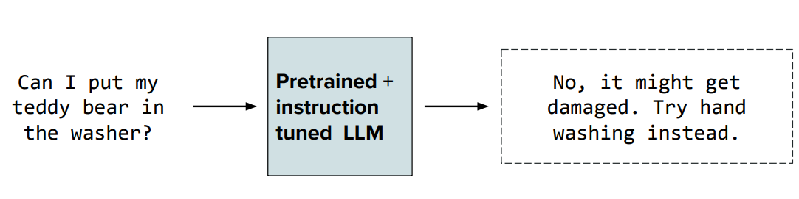


### Parameter-efficient fine-tuning with LoRA (Low Rank Adaptation)

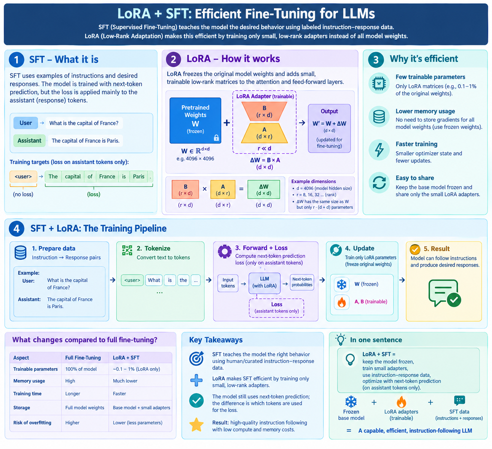

> LoRA makes easy to train the same pretrained model for different fine-tuning tasks, because we can isolate the 
> fine-tuning trained weights

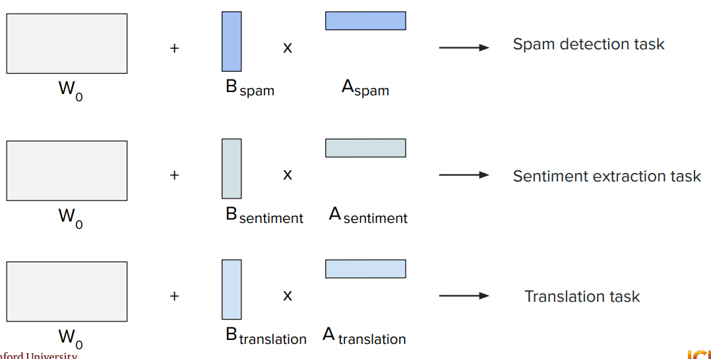

#### Where LORA applies

Even though lora is nowadays applied to both self-attention layer and FFNN layer it has been demonstrated that 
it gives better performance improvement on the FFNN layer.

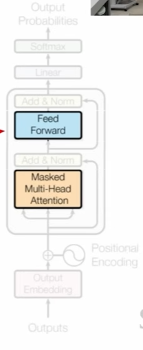

#### Quantization

In order to reduce the memory footpring of LORA, some approaches use float quantization of the pre-trained 
matrices and the fine-tune matrices $A$ and $B$ in full precision, including the computation of the matrix operations

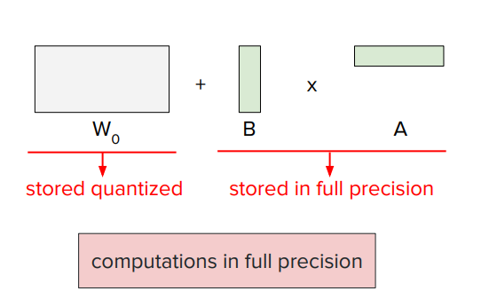